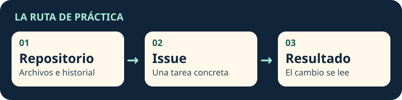

# En palabras simples

Guías visuales en español para aprender tecnología haciendo. **Una guía, una tarea y un resultado que puedes comprobar.** Empieza en el navegador, sin instalar Git ni escribir comandos.

## Empieza por aquí

**[GitHub desde cero → ver el índice](github/README.md)**

- **[01 · Crea tu repositorio con un README](github/01-repositorio-y-readme.md)**: dale un lugar a tu proyecto y explica qué contiene.
- **[02 · Crea tu primer issue](github/02-primer-issue.md)**: registra una mejora concreta para ese mismo proyecto.
- **[03 · Tu primer commit](github/03-primer-commit.md)**: crea un archivo, guarda el cambio y encuéntralo en el historial.
- **[04 · Ramas y pull requests](github/04-ramas-y-pull-requests.md)**: revisa un cambio, incorpóralo y comprueba el cierre de la tarea.

## Cómo usar estas guías

En cada capítulo, cada tema responde **¿Por qué?**, **¿Para qué?**, **¿Cómo?** y **¿Cuándo usarlo?**, con un ejemplo y una forma de comprobar el resultado.

1. **Lee** para entender qué harás y por qué.
2. **Practica** en un repositorio propio con datos de ejemplo.
3. **Comprueba** que obtuviste el resultado. Usa la documentación oficial si necesitas más detalle.

Las imágenes son **maquetas didácticas**, no capturas exactas de GitHub. No necesitas publicar datos reales para practicar.

## Sigue practicando

¿Ya tienes tu repositorio de práctica? Explora el [portafolio académico](https://github.com/jokxer8/soluciones-programacion-academica) para ver ejemplos de cómo se documentan ejercicios, proyectos y resultados. También puedes volver al [perfil de Jokxer8](https://github.com/jokxer8#guías-visuales-en-palabras-simples).
