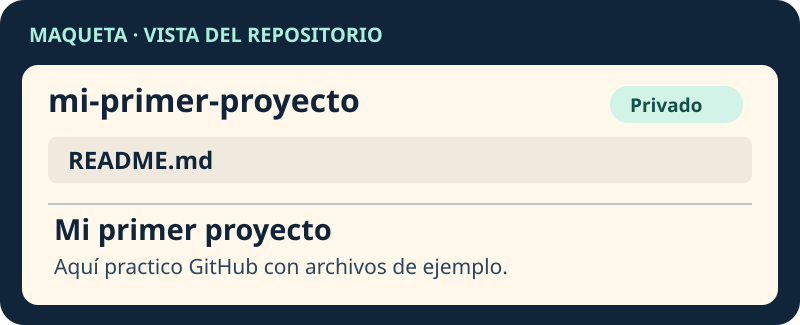

# 01 · Crea tu repositorio con un README

[← Índice](README.md) · [Siguiente: tu primer issue →](02-primer-issue.md)

**Meta:** crear `mi-primer-proyecto` en GitHub y dejar una presentación que se lea al entrar. **Tiempo estimado:** 5–8 minutos.

## En palabras simples

Un **repositorio** es el espacio de tu proyecto: guarda archivos y su historial. El **README** es la hoja de bienvenida. Dice qué es el proyecto y por dónde empezar.



## ¿Por qué?

Para que los archivos de tu proyecto no queden dispersos y alguien que llegue por primera vez sepa de qué se trata.

## ¿Para qué?

Usa el repositorio para guardar el trabajo y el README para explicar qué contiene, cómo empezar y dónde buscar lo importante.

## ¿Cuándo usarlo?

Al iniciar un proyecto, incluso si todavía no tienes código. Actualiza el README cuando cambie lo que otra persona necesita saber para usarlo.

## ¿Cómo?

1. En GitHub, abre **+ → New repository**. Ponle `mi-primer-proyecto` y confirma que el propietario sea tu cuenta.
2. Elige **Private** para practicar. Activa **Add README** y pulsa **Create repository**.
3. En tu nuevo repositorio, abre `README.md` y pulsa el lápiz **Edit this file**. Reemplaza el contenido con el ejemplo de abajo.
4. Guarda con **Commit changes** y usa un mensaje claro, como `Explicar el propósito del proyecto`. Guarda en la rama actual de tu repositorio de práctica si GitHub te pide elegir.

```markdown
# Mi primer proyecto

Aquí practico GitHub con archivos de ejemplo.

## Qué encontrarás

Notas y ejercicios que puedo compartir sin usar datos reales.
```

## Comprueba que funcionó

En la pestaña **Code**, debes ver `README.md` en la lista y el título **Mi primer proyecto** debajo. Si todavía dice el nombre antiguo, revisa si guardaste el cambio en la rama que estás viendo.

**Antes de compartir:** guardar un archivo no cambia la visibilidad del repositorio. Si quieres hacerlo público más adelante, revisa los archivos y su historial; no subas secretos, datos privados ni material ajeno sin permiso.

[Documentación oficial de GitHub: crear un repositorio](https://docs.github.com/es/repositories/creating-and-managing-repositories/creating-a-new-repository)
