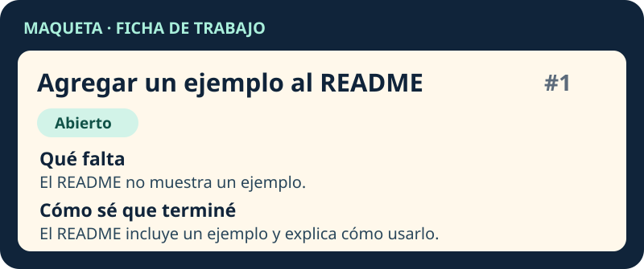

# 02 · Crea tu primer issue

[← Índice](README.md) · [Anterior: crea tu repositorio](01-repositorio-y-readme.md) · [Siguiente: tu primer commit →](03-primer-commit.md)

**Meta:** registrar una mejora para tu propio proyecto y saber cuándo cerrarla. **Tiempo estimado:** 5 minutos.

## En palabras simples

Un **issue** es una ficha para seguir una tarea, un error o una mejora. Si el repositorio es el cuaderno del proyecto, un issue es la nota que dice **qué falta hacer**. Crear la ficha no cambia los archivos.

## 1. Crear una ficha de trabajo (issue)

- **¿Por qué?** Una tarea que queda solo en una conversación es fácil de olvidar o interpretar de otra manera.
- **¿Para qué?** Para dejar en un solo lugar qué falta y cómo sabrás que está listo.
- **¿Cómo?** En tu repositorio de práctica, abre **Issues → New issue**. Si ves plantillas, elige una de tarea o el formulario en blanco. Usa el título **Agregar un ejemplo al README** y escribe: «El README no muestra un ejemplo. Está listo cuando incluya un ejemplo y explique cómo usarlo». Pulsa **Create** o el botón de envío.
- **¿Cuándo usarlo?** Cuando descubras un error, quieras proponer una mejora o necesites anotar una tarea que no resolverás ahora.

## 2. Decidir cuándo cerrar un issue

- **¿Por qué?** Si cierras la ficha antes de tiempo, la tarea deja de aparecer entre las pendientes.
- **¿Para qué?** Para que quede claro que se cumplió lo que pedía la ficha, y dónde se puede ver.
- **¿Cómo?** Lee el criterio de la ficha. Cuando el ejemplo y las instrucciones estén en el README, añade un comentario que indique dónde quedaron y pulsa **Close issue**. En este ejercicio todavía no hay que cerrarlo.
- **¿Cuándo usarlo?** Cierra el issue después de comprobar que el trabajo cumple su criterio. Si aún falta algo, déjalo abierto.

## Comprueba que funcionó

Vuelve a **Issues**. La ficha debe aparecer abierta, con un número como `#1`. Ábrela y revisa que otra persona pueda entender qué hacer y cómo comprobar que quedó listo.

**¿No aparece Issues?** Revisa que la función esté habilitada en el repositorio de práctica. No abras tareas ficticias en repositorios de otras personas. En un repositorio público, tampoco pongas datos privados o secretos en la ficha.

[Documentación oficial de GitHub: crear un issue](https://docs.github.com/es/issues/tracking-your-work-with-issues/using-issues/creating-an-issue)
