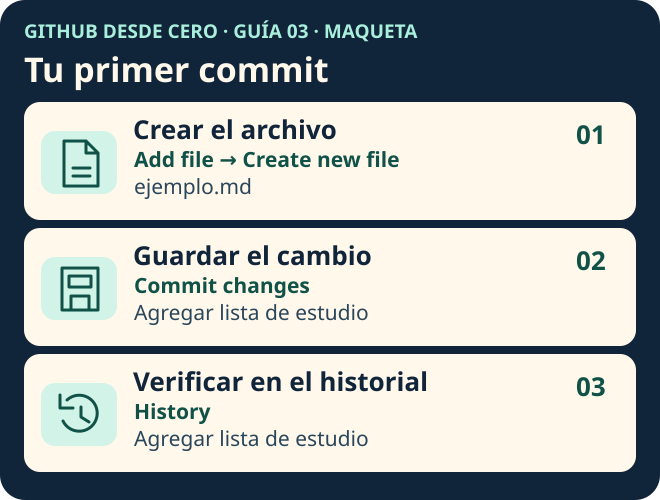

# 03 · Tu primer commit, sin usar la terminal

[← Índice](README.md) · [Anterior: tu primer issue](02-primer-issue.md)

**Meta:** crear `ejemplo.md` y encontrar el cambio guardado en el historial. **Tiempo estimado:** 5 minutos. Usa tu repositorio privado `mi-primer-proyecto`.

## En palabras simples

Un **commit** es un punto guardado en el historial del proyecto. Lleva un mensaje que cuenta qué cambió. Es como guardar una versión de tu trabajo con una etiqueta que luego puedes reconocer.

## ¿Por qué?

Porque en unas semanas quizá no recuerdes qué cambiaste. Un mensaje como «Agregar lista de estudio» te da una pista mucho más útil que «Cambios».

## ¿Para qué?

Para ver el cambio concreto sin adivinar: al abrir el commit de este ejercicio, verás cuándo se añadió `ejemplo.md` y qué líneas incluía.

## ¿Cuándo usarlo?

Cuando termines un cambio con sentido propio: añadir un ejemplo, corregir una instrucción o arreglar un error. No necesitas guardar un commit por cada tecla ni esperar a terminar todo el proyecto.

## ¿Cómo?



1. En tu repositorio de práctica, entra a **Code → Add file → Create new file**. En el nombre escribe `ejemplo.md`.
2. Copia esta lista y usa **Preview** para ver cómo se muestra antes de guardarla:

```markdown
# Lista de estudio

- [x] Crear mi primer repositorio
- [ ] Repasar GitHub
```

3. Pulsa **Commit changes…** y escribe `Agregar lista de estudio` como mensaje. Para este ejercicio individual, elige guardar directamente en la rama que estás usando (normalmente `main`), si tu repositorio de práctica lo permite. Confirma con **Commit changes**. En un proyecto compartido, usa una rama aparte y sigue sus reglas de revisión.
4. Abre `ejemplo.md` y pulsa **History** (historial). Busca tu mensaje y ábrelo: debes ver el archivo añadido y sus líneas nuevas.

## Comprueba que funcionó

- [ ] `ejemplo.md` aparece en **Code** y muestra la lista.
- [ ] **History** contiene **Agregar lista de estudio**, y el cambio corresponde a ese archivo.

**¿No ves el archivo?** Comprueba que estés mirando la misma rama en la que guardaste el commit. Confirma también que escribiste el nombre con la extensión `.md`.

Deja abierto el issue **Agregar un ejemplo al README** de la guía anterior: ya creaste el archivo de ejemplo, pero todavía no lo explicaste en el README. Ese será el trabajo de la próxima guía.

[Documentación oficial de GitHub: crear archivos desde el navegador](https://docs.github.com/es/repositories/working-with-files/managing-files/creating-new-files)
