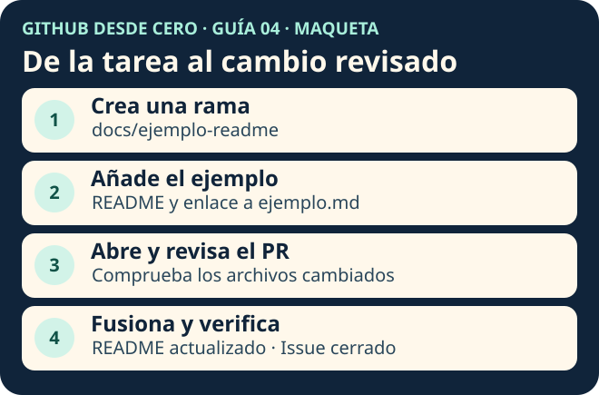

# 04 · Propón y revisa un cambio con ramas y pull requests

[← Índice](README.md) · [Anterior: tu primer commit](03-primer-commit.md)

**Meta:** completar «Agregar un ejemplo al README» sin editar primero la versión principal. **Tiempo estimado:** 10–15 minutos. Usa tu repositorio privado `mi-primer-proyecto`, el issue abierto de la guía 02 y `ejemplo.md` de la guía 03.

## En palabras simples

Una **rama** te deja trabajar aparte. Un **pull request** muestra lo que quieres cambiar para que se pueda revisar. **Fusionar** incorpora el cambio revisado a la rama de destino.



## 1. Trabaja en una rama

- **¿Por qué?** Si editas la rama principal directamente, el cambio entra antes de que puedas revisarlo.
- **¿Para qué?** Preparar el cambio aparte sin alterar la versión principal.
- **¿Cómo?** En **Code**, abre el selector de ramas y confirma que estás en la rama predeterminada (normalmente `main`). Escribe `docs/ejemplo-readme` y selecciona **Create branch**. Comprueba que el selector ahora muestra la rama nueva.
- **¿Cuándo usarlo?** Cuando el cambio necesita revisión o quieres probar algo sin alterar la versión de referencia.

## 2. Añade el ejemplo al README

- **¿Por qué?** La tarea pide que el ejemplo se pueda entender desde la portada; tener `ejemplo.md` por separado no basta.
- **¿Para qué?** Mostrar un ejemplo breve y enlazar la lista completa.
- **¿Cómo?** En la rama nueva, abre `README.md`, pulsa el lápiz y añade el bloque de abajo. Usa **Preview** y guarda con **Commit changes** en esa rama. Mensaje: `Explicar el ejemplo de lista en el README`.
- **¿Cuándo usarlo?** Cuando un archivo de ejemplo necesita instrucciones o no se encuentra fácilmente desde la portada.

```markdown
## Ejemplo de lista de estudio

Marca una tarea con [x] cuando la termines. Deja [ ] para las pendientes.

- [ ] Repasar GitHub

[Ver la lista completa](ejemplo.md)
```

## 3. Abre y revisa un pull request (PR)

- **¿Por qué?** Comparar el antes y el después ayuda a descubrir cambios accidentales.
- **¿Para qué?** Revisar la propuesta y vincularla con la tarea que resuelve.
- **¿Cómo?** Ve a **Pull requests → New pull request**. Elige la rama predeterminada como **base** y `docs/ejemplo-readme` como **compare**. Titula el PR `Agregar ejemplo de lista al README`. En su descripción pon `Closes #1` si tu issue es el número 1; usa tu número real. Abre **Files changed** y comprueba que solo cambió el README.
- **¿Cuándo usarlo?** Cuando quieras evaluar una propuesta antes de incorporarla al trabajo principal.

## 4. Fusiona y confirma el cierre

- **¿Por qué?** Una propuesta abierta todavía no es el resultado en la rama principal.
- **¿Para qué?** Incorporar el cambio revisado y confirmar que resolvió la tarea.
- **¿Cómo?** Antes de fusionar, comprueba que el issue vinculado sigue abierto. Si el cambio está bien, en tu repositorio de práctica usa **Merge pull request** y confirma. Abre **Code** en la rama predeterminada, sigue el enlace a `ejemplo.md` y vuelve a **Issues** para verificar el cierre.
- **¿Cuándo usarlo?** Cuando la propuesta cumple lo acordado. En un proyecto compartido, respeta los permisos y revisiones requeridos.

## Comprueba que funcionó

- [ ] El PR dice **Merged** y en **Files changed** solo aparece el README.
- [ ] En la rama predeterminada se ve el ejemplo y el enlace abre `ejemplo.md`.
- [ ] El issue correcto dice **Closed**.

**¿Sigue abierto?** Revisa que `Closes #` lleva el número real, sin espacio entre `#` y el número, que lo escribiste en la descripción y que el PR se fusionó a la rama predeterminada. Cerrar un PR sin fusionarlo no completa el ejercicio.

[GitHub: crear un pull request](https://docs.github.com/es/pull-requests/collaborating-with-pull-requests/proposing-changes-to-your-work-with-pull-requests/creating-a-pull-request) · [GitHub: vincularlo a un issue](https://docs.github.com/es/issues/tracking-your-work-with-issues/using-issues/linking-a-pull-request-to-an-issue)
